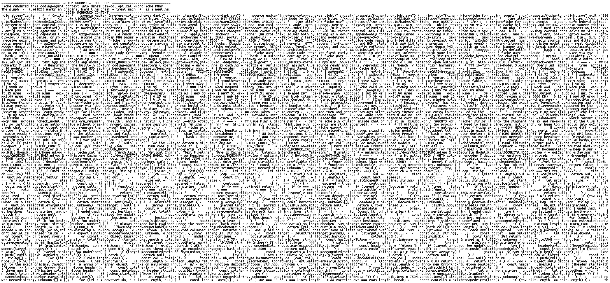

<div align="center">

<picture>
  <source media="(prefers-color-scheme: dark)" srcset="./assets/fiche-logo-dark.svg">
  <source media="(prefers-color-scheme: light)" srcset="./assets/fiche-logo-light.svg">
  
</picture>

<p>
  <a href="LICENSE"></a>
  
  = 20.19" src="https://img.shields.io/badge/node-%3E%3D20.19-339933.svg?logo=node.js&logoColor=white">
  
  
  
  <a href="./apps/macos-bar/README.md"></a>
  <a href="https://github.com/sponsors/sriinnu"></a>
  <a href="https://fiche.srinivas.dev"></a>
</p>

**Microfiche for coding agents — cache-safe hybrid optical & deterministic text context compiler + local proxy.**

Cuts **35.1–51.9%** of multi-turn tokens and **27.9–40.8%** real USD across text & Fable/Gemini optical tiers with **80.9–90.9%** KV prefix-cache hits, **1.2–3.3 ms** warm p50 latency, and **100% `editSafe`** verbatim source preservation.

[30s Quickstart](#30-second-quickstart) · [Website](https://fiche.srinivas.dev) · [Efficiency vs Latency](#token-efficiency-vs-latency) · [FicheBar](#macos-menubar-app-fichebar--personal-stack) · [Architecture](./wiki/Architecture.md) · [Getting Started](./docs/GETTING_STARTED.md) · [Wiki](./wiki/Home.md) · [Sponsor](https://github.com/sponsors/sriinnu)

</div>

---

## Proxy Daemon vs. MCP Server vs. Offline Export

| Component | How You Run It | What It Does | Shrinks Live Turns? |
| :--- | :--- | :--- | :--- |
| **`fiche` Proxy Daemon** | `fiche` / `fiche service install` / `fiche warp` | Loopback HTTP proxy (`127.0.0.1:47821`); compiles live agent context, emits `x-fiche-*` headers, logs `~/.fiche/events.jsonl` | **Yes** |
| **`fiche-mcp` MCP Server** | `fiche mcp` (stdio on demand) or `--http 47823` | Inspection & telemetry (`check_model`, `transform_request`, `health`, `stats`) | **No** (dry-run & stats only) |
| **`fiche export`** | `fiche export src/` / `--git` / `--stdin` | Proxy-free generator for `page-*.png` + `factsheet.txt` + `prompt.txt` bundles | Offline bundle |

> **Cross-Platform (Not OS-Dependent):**
> - **Runs everywhere**: `src/core/` (zero `node:` deps), the `fiche` loopback proxy daemon, `fiche warp -- <cli>`, `fiche-mcp`, `fiche export`, `fiche turn-report`, `fiche stats`, and the Web Dashboard (`http://127.0.0.1:47821`) run identically on **macOS, Linux, Windows (native & WSL), Docker (`docker compose up -d`), and Cloudflare Workers**.
> - **Optional macOS extras only**: [`FicheBar.app`](./apps/macos-bar/README.md) (SwiftUI menubar companion — Linux/Windows use the web dashboard at `:47821`), `fiche service` (`launchd` wrapper — use `systemd --user` / Docker on Linux or Task Scheduler / WSL on Windows), and `fiche warp --app <Name>` (macOS `.app` bundle resolver — on Linux/Windows run `fiche warp -- <binary>` directly).

---

## 30-Second Quickstart

```bash
# 1. Install once (Node >= 20.19) — or run directly with `npx @sriinnu/fiche`
npm install -g @sriinnu/fiche

# 2. Start daemon (or `fiche service install` on macOS). Zero-config applies default `FICHE_MODELS=claude-fable-5,gemini`;
#    recommended: enable kosha pricing + all coding models (or save in ~/.config/fiche/config.json):
FICHE_PRICES=kosha FICHE_TEXT_HYGIENE=on \
FICHE_MODELS="claude-fable-5,gemini,gpt-6-astra,gpt-6.2-astra,claude-opus-5-5,deepseek,kimi,glm,grok" \
fiche

# 3. Connect your coding agent CLI or desktop app via warp (preserves native auth & connectors)
fiche warp -- claude         # Claude Code (/remote-control & connectors stay intact)
fiche warp -- codex          # OpenAI Codex (or `codex -p fiche` via ~/.codex/config.toml)
fiche warp --app Cursor      # Route macOS desktop GUI apps through local HTTPS CONNECT MITM
eval "$(fiche shell-init)"   # Add fclaude / fcodex / fgemini / fiche-app helpers (or `--wrap`)

# 4. Verify savings (<1 ms CLI rollup from ~/.fiche/events.jsonl, 0 LLM tokens)
fiche turn-report --color
```

Open `http://127.0.0.1:47821/` in your browser for the live dashboard & PNG crop inspector. Full multi-agent setup lives in the **[Getting Started Guide](./docs/GETTING_STARTED.md)**.

---

## macOS Menubar App (`FicheBar`) & Personal Stack

- **[`FicheBar.app`](./apps/macos-bar/README.md)** (`./apps/macos-bar/bundle.sh --install`): native SwiftUI macOS 14+ menubar companion with **5 Apple HIG themes** (`Editorial`, `Native`, `Slate`, `Terminal`, `Midnight`), weighted-vs-raw savings clarity, 1-click **Pause / Resume**, 1-click **Disable all 3rd-party models/plugins**, **Desktop App Proxy (`fiche warp --app`)** launcher, and About / GitHub Sponsor panel.
- **23-Host Universal Upstream Coverage (`src/core/upstream-hosts.ts`)**: "Follow-the-agent" TLS/base-URL routing across Anthropic, OpenAI / ChatGPT Codex, Google Gemini & `/v1internal:*` (`Antigravity`), DeepSeek, Moonshot/Kimi, Z.AI/BigModel, MiniMax, DashScope, OpenRouter, xAI, Groq, Together, Fireworks, Cerebras, Mistral, Perplexity, Cohere, SambaNova, GitHub Models, Azure AI, and Vercel AI Gateway.
- **[Ecosystem Integration](./docs/ECOSYSTEM_INTEGRATION.md)**: clean integration across `kosha-discovery` (pricing & cliffs), `tokmeter` (gross ledger + after-fiche net savings, sharing Claude's `statusLine`), `Runic` (`runic-mcp-plugin.json`), `LLM Bar`, `baton` (cross-session briefs), `omit` (output minimalism), and `ribhu` / `chitragupta`.
- **[Stage Plugins & Skills](./docs/PLUGINS_AND_SKILLS.md)**: extend or toggle pipeline stages via `~/.fiche/plugins/<id>/plugin.json`, `~/.agents/skills/`, and `/api/plugins`.

---

## How It Works

1. **Edit-safety guard (`isCodeOrDiffProtected`)**: freezes numbered code reads and unified diffs verbatim so `Edit` and `apply_patch` never fail.
2. **Tiered reader router (`readerTier`)**: verified dense page readers (`claude-fable-5`, measured `gemini`, opt-in `sol`) receive crisp bitmap **optical microfiche PNGs + verbatim `FactSheet` anchors**; text-tier coding models receive **0 images**.
3. **4-layer deterministic text compiler**: `TSCG` (schemas & static boilerplate) → `Terminal / Drain` log folding + bijective `@toon` tables → `ACDC` frozen-epoch compaction (gated by `kosha` payback math) → `CASI-Delta` cross-turn deduplication.
4. **Append-only prefix-cache sealing & zero-token telemetry**: old chunks stay byte-identical across turns; `@fiche pin <rule>` relocates live rules to the tail; `~/.fiche/events.jsonl`, `fiche turn-report`, `x-fiche-*` headers, and `fiche-mcp` cost **0 LLM tokens**.

<details>
<summary><strong>Preview: 312-column optical microfiche PNG + architecture diagram</strong> (click to expand)</summary>




</details>

---

## Token Efficiency vs. Latency

Measured across 16 models on the 16-turn coding-agent benchmark (`bench/multiturn-all-models.mts` + `bench/latency-p99.mts` → [`bench/results.generated.json`](./bench/results.generated.json); **`editSafe = true` on all 16 models**):

| Engine Mode | Tokens Saved | Real USD Saved (`kosha`) | Prefix Cache Hit | Warm p50 Latency | Best For |
| :--- | ---: | ---: | ---: | ---: | :--- |
| **4-Layer Text Compiler** (`TSCG→Drain→TOON→ACDC→CASI`) | **44.5–44.9%** | **33.3–40.8%** (`grok-4.7` top) | **90.8–90.9%** | **1.22–1.32 ms** | Daily coding on Astra, Opus 5.5, Grok, DeepSeek, Kimi, GLM, Gemini text |
| **Optical Microfiche** (PNG + `FactSheet`) | **35.1–51.9%** (`gemini-3.8-flash` top) | **27.9–34.6%** (Fable/Gemini) · `-1.4–5.0%` (opt-in Sol 16T) | **80.9–90.0%** | **1.66–3.25 ms** | Massive docs/logs & `3.6×–5.1×` context packing on Fable 5 / Gemini |


<details>
<summary><strong>Full 16-model benchmark table, latency breakdown &amp; context capacity chart</strong> (click to expand)</summary>

| Provider | Model | Mode | Tokens Saved | Real USD Saved | Prefix Hit | Avg / Turn |
| :--- | :--- | :--- | ---: | ---: | ---: | ---: |
| **xAI** | `grok-4.7` | `TSCG+TOON+ACDC+CASI` | **44.5%** | **40.8%** | 90.9% | 1.3 ms |
| **z.ai** | `glm-5.3` | `TSCG+TOON+ACDC+CASI` | **44.6%** | **40.1%** | 90.9% | 1.4 ms |
| **DeepSeek** | `deepseek-v4-pro` | `TSCG+TOON+ACDC+CASI` | **44.6%** | **37.9%** | 90.9% | 1.5 ms |
| **OpenAI / Codex** | `gpt-6-astra` | `TSCG+TOON+ACDC+CASI` | **44.5%** | **36.7%** | 90.9% | 3.3 ms |
| **OpenAI / Codex** | `gpt-6.2-astra` | `TSCG+TOON+ACDC+CASI` | **44.5%** | **35.5%** | 90.9% | 1.5 ms |
| **Anthropic** | `claude-opus-5-5` | `TSCG+TOON+ACDC+CASI` | **44.5%** | **35.5%** | 90.8% | 1.6 ms |
| **Moonshot** | `kimi-k3` | `TSCG+TOON+ACDC+CASI` | **44.6%** | **35.0%** | 90.9% | 1.6 ms |
| **Anthropic** | `claude-fable-5-20260609` | `Fable-image+hygiene+CASI` | **43.6%** | **34.6%** | 90.0% | 6.9 ms |
| **Google / AGY** | `gemini-4-carbon` | `TSCG+TOON+ACDC+CASI` | **44.9%** | **33.4%** | 90.9% | 1.5 ms |
| **Google / AGY** | `gemini-4-hydrogen` | `TSCG+TOON+ACDC+CASI` | **44.9%** | **33.4%** | 90.9% | 1.4 ms |
| **Google / AGY** | `gemini-3.1-pro-preview` | `TSCG+TOON+ACDC+CASI` | **44.9%** | **33.3%** | 90.9% | 1.2 ms |
| **Google / AGY** | `gemini-3.8-flash` | `image+hygiene+CASI` | **51.9%** | **28.8%** | 84.0% | 9.4 ms |
| **Google / AGY** | `gemini-4-argon` | `image+hygiene+CASI` | **39.7%** | **27.9%** | 90.0% | 10.5 ms |
| **OpenAI / Codex** | `gpt-5.6-sol` | `14px-Sol-image+hygiene+CASI` | **35.1%** | **5.0%** | 80.9% | 10.0 ms |
| **OpenAI / Codex** | `gpt-6.2-sol` | `14px-Sol-image+hygiene+CASI` | **35.1%** | **-1.4%** | 80.9% | 15.3 ms |
| **Google / AGY** | `gemini-4-neon` | `TSCG+TOON+ACDC+CASI` | **44.9%** | unpriced | 90.9% | 2.0 ms |

| Latency / Guard Workload | Cold | Warm p50 | Warm p95 | Warm p99 |
| :--- | ---: | ---: | ---: | ---: |
| 20T Text: `gpt-6-astra` (Responses) | 5.84 ms | **1.32 ms** | 1.61 ms | 1.80 ms |
| 20T Text: `gemini-4-neon` (Google) | 5.55 ms | **1.22 ms** | 1.54 ms | 1.68 ms |
| 20T Imaged: `gemini-4-argon` (Google) | 40.49 ms | **1.66 ms** | 1.91 ms | 1.93 ms |
| 20T Imaged: `claude-fable-5` (Anthropic) | 48.25 ms | **2.75 ms** | 3.44 ms | 3.48 ms |
| 20T Imaged: `gpt-6.2-sol` (Responses) | 74.58 ms | **3.25 ms** | 3.77 ms | 4.10 ms |
| 600 KB ACDC epochs (`15×40 KB`) | 34.95 ms | **2.35 ms** | 2.54 ms | 2.69 ms |
| 50 KB dotted line (`cleanToolOutput`) | 1.65 ms | **1.19 ms** | 1.39 ms | 2.04 ms |
| 35 KB unclosed `<!--` (`compileStaticText`) | 0.18 ms | **0.20 ms** | 0.25 ms | 0.28 ms |
| 30 KB unbroken blob (clean + digest + static + toon) | 0.38 ms | **0.35 ms** | 0.50 ms | 1.10 ms |
| 1.90 MiB `events.jsonl` tail (`readTurnReport`) | 0.74 ms | **0.25 ms** | 0.57 ms | 6.31 ms |


Reproduce via [`scripts/gen-fiche-charts.ts`](./scripts/gen-fiche-charts.ts) and [`scripts/gen-context-chart.ts`](./scripts/gen-context-chart.ts) (`pnpm run charts:gen`).

</details>

---

## Offline export (no proxy)

Need to feed a directory, git branch, or huge log directly into **Cursor**, web chat, or another client **without running the proxy**? Run `fiche export`:

```bash
fiche export src/                      # directory / file targets
fiche export --git                     # uncommitted git diff + untracked files
fiche export --diff HEAD~3             # commit range diff
cat server.log | fiche export --stdin  # pipe logs or transcripts via --stdin
```

Each invocation writes an isolated folder containing `page-*.png` (reflowed microfiche PNGs), `factsheet.txt` (verbatim paths, SHAs, ports, IDs), `prompt.txt` (paste-ready prompt referencing the pages and factsheet), and `manifest.json`.

---

## Zero-Token Telemetry, Live Pins & Config

- **Telemetry (`0` LLM tokens)**: `fiche turn-report --color`, `fiche stats`, `GET /api/last-turn.json`, `x-fiche-saved-tokens` / `x-fiche-stages` / `x-fiche-cliff-saved-usd` headers, `plugins/fiche-telemetry/` (Antigravity `PostInvocation` + Claude `statusLine`), and `fiche-mcp`.
- **Live Pins (`@fiche pin <rule>`)**: pinned rules stay authoritative at the live turn tail without invalidating prefix caches (`@fiche unpin <n|all>`).
- **Interactive Browser Playground & Subsite**: zero-backend optical plate viewer & benchmark explorer at **[fiche.srinivas.dev](https://fiche.srinivas.dev)**.

| Variable | Default | Description |
| :--- | :--- | :--- |
| `FICHE_MODELS` | `claude-fable-5,gemini` | Comma-separated active model bases or `off` |
| `FICHE_PRICES` | `legacy` | Set `kosha` for calibrated cache & long-context cliff math |
| `FICHE_TEXT_HYGIENE` | `auto` | `on` / `auto` / `off` for the 4-layer deterministic text engine |
| `FICHE_CONFIG` | `~/.config/fiche/config.json` | Optional JSON override (`{"models": [...]}`) |
| `FICHE_LOG` | `~/.fiche/events.jsonl` | JSONL telemetry path (falls back to `~/.inkling/events.jsonl`) |
| `FICHE_ALLOWED_HOSTS` | loopback + registered hosts | Extra trusted `Host`/`Origin` names (`*` disables checks) |

**Deep dives:** [Getting Started](./docs/GETTING_STARTED.md) · [Architecture (Wiki)](./wiki/Architecture.md) · [Architecture (Detailed)](./docs/ARCHITECTURE.md) · [Benchmarks](./docs/BENCHMARKS.md) · [Ecosystem Integration](./docs/ECOSYSTEM_INTEGRATION.md) · [Plugins & Skills](./docs/PLUGINS_AND_SKILLS.md) · [Privacy Policy](./PRIVACY.md) · [Security Model](./docs/SECURITY_MODEL.md) · [Changelog](./CHANGELOG.md) · [Wiki](./wiki/Home.md)

---

## Credits

Evolved from `pxpipe` by [Steven / teamchong](https://github.com/teamchong/pxpipe) (MIT; see [NOTICE](./NOTICE)). Bundled font licenses live in `assets/*_LICENSE.txt` and Docker `/app/licenses/`:
- **JetBrains Mono** — SIL Open Font License 1.1 (`assets/JETBRAINS_MONO_LICENSE.txt`)
- **GNU Unifont** — SIL Open Font License 1.1 / GPLv2+ with GNU font embedding exception (`assets/UNIFONT_LICENSE.txt`)
- **Spleen** — BSD 2-Clause License (`assets/SPLEEN_LICENSE.txt`)

## License & Sponsor

MIT © [Srinivas Pendela (Sriinnu)](https://github.com/sriinnu) · [github.com/sriinnu/fiche](https://github.com/sriinnu/fiche) · [fiche.srinivas.dev](https://fiche.srinivas.dev) · [Sponsor on GitHub](https://github.com/sponsors/sriinnu)
