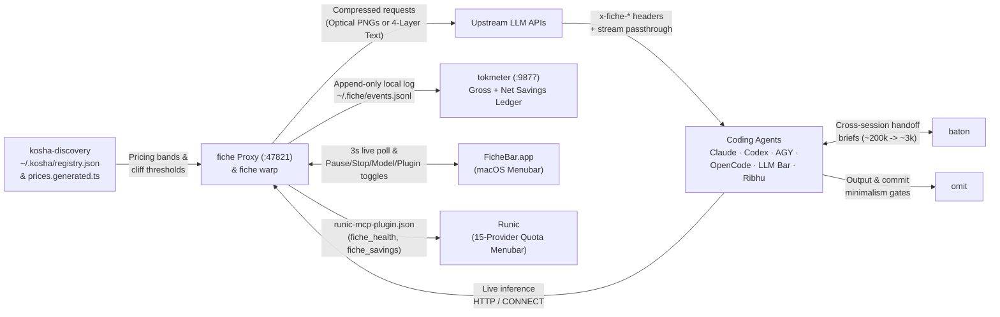

# Ecosystem Integration Guide

`fiche` is built as a modular layer inside a local-first AI developer stack alongside [`kosha-discovery`](https://github.com/sriinnu/kosha-discovery), [`tokmeter`](https://github.com/sriinnu/tokmeter), [`Runic`](https://github.com/sriinnu/Runic), [`baton`](https://github.com/sriinnu/baton), [`omit`](https://github.com/sriinnu/omit), `LLM Bar`, and `ribhu` / `chitragupta`. Every tool has a clean responsibility boundary with zero double-counting or lock-in.

---

## Architecture Overview



---

## 1. `kosha-discovery` — Pricing Truth & Context Cliff Math

- **Build-time table**: `pnpm run prices:gen` reads `kosha registry export` (schema v1) and writes [`src/core/prices.generated.ts`](../src/core/prices.generated.ts) (verified in CI by `pnpm run prices:check`).
- **Runtime activation (`FICHE_PRICES=kosha`)**: enables calibrated cache-read, cache-write (5-minute and 1-hour TTL), and long-context price-cliff tiers (for example `200K` / `272K` jumps).
- **Where it matters inside `fiche`**:
  - **Payback & cliff gates (`ACDC` + optical profitability gate)** decide whether compressing old turns actually saves *dollars* after cache write/read multipliers, avoiding the trap of saving tokens while raising your bill.
  - **Downstream header**: when compression keeps a turn below a long-context price cliff, `fiche` emits `x-fiche-cliff-saved-usd` and records `cliffSavedUsd` in `~/.fiche/events.jsonl`.

---

## 2. `fiche` Daemon + `FicheBar.app` — Live Compression & Instant Control

- **Loopback HTTP proxy (`127.0.0.1:47821`)** managed via `fiche service install` (`~/Library/LaunchAgents/com.sriinnu.fiche.plist` with label `com.sriinnu.fiche`).
- **Native macOS companion ([apps/macos-bar/README.md](../apps/macos-bar/README.md))**:
  - Polls `/api/health`, `/proxy-stats`, `/api/last-turn.json`, `/api/models`, and `/api/plugins` every 3 seconds.
  - Shows live token/dollar savings (`-48% · $1.24`) in the menu bar.
  - One-click **Pause / Resume** (`POST /api/compression`), **Stop / Restart** (`POST /api/shutdown`), live **Models** chips, and **Stages & Skills** toggles.

---

## 3. `baton` — Between-Session Compression Complement

`baton` and `fiche` operate on orthogonal axes:

| Layer | What It Compresses | Typical Ratio | Mechanism |
| :--- | :--- | :--- | :--- |
| **`fiche`** | **Inside** every live turn | `35–52%` tokens, `28–41%` USD | Prefix-cache-safe optical PNGs & 4-layer deterministic text (`TSCG → Drain → TOON → ACDC → CASI`) |
| **`baton`** | **Between** sessions / agents | `200k → ~3k` brief | Git-verified `/baton:handover` & `/baton:takeover` markdown briefs when switching models or starting fresh sessions |

Running both together compounds cleanly: each active session stays lean via `fiche` while hitting ~90.9% KV cache hits, and cross-model handovers reset context cleanly via `baton` instead of paying cold-cache writes on 200k histories.

---

## 4. `omit` — Input Hygiene + Output Minimalism

- **`fiche`** optimizes **prompt inputs** (tool results, verbose logs, schemas, aged conversation turns) while `isCodeOrDiffProtected()` keeps source reads and diffs byte-identical so exact edits never break.
- **`omit`** enforces **output minimalism** (editorial hooks, citation checks, pre-commit / CI bloat gates) so agents don't introduce unrequested abstractions or redundant dependencies.

---

## 5. `tokmeter` — Gross Spend Ledger + After-Fiche Net Savings

`tokmeter` runs its own local daemon (`127.0.0.1:9877`) that reads native on-disk session logs across 24 agents (Claude Code, Codex, Gemini CLI, Cursor, etc.) to build your authoritative **gross billed spend** ledger.

### Avoiding Double-Counting

- **Tokmeter owns billed spend** parsed from provider/agent session logs.
- **Fiche owns compression delta** logged per proxied request to `~/.fiche/events.jsonl` (`$FICHE_LOG`) and served via `GET http://127.0.0.1:47821/api/last-turn.json` and `GET http://127.0.0.1:47821/proxy-stats`.
- Joining `~/.fiche/events.jsonl` (fields: `ts`, `model`, `savedTokens`, `savedUsd`, `cliffSavedUsd`, `stages`) alongside Tokmeter's daily/session totals lets Tokmeter display **Gross Billed vs. After-Fiche Net Spend & Saved $** without ever double-counting tokens.

### Sharing Claude Code's Single `statusLine`

Claude Code supports a single `statusLine.command` in `~/.claude/settings.json`. Combine `tokmeter` and `fiche` cleanly with a tiny wrapper script:

```bash
#!/usr/bin/env bash
# ~/.local/bin/claude-statusline-combined.sh (chmod +x)
INPUT="$(cat)"
TOK_LINE="$(printf '%s' "$INPUT" | tokmeter statusline 2>/dev/null || true)"
FICHE_LINE="$(fiche turn-report --format=claude-statusline 2>/dev/null || true)"

if [ -n "$TOK_LINE" ] && [ -n "$FICHE_LINE" ]; then
  printf '%s  |  %s\n' "$TOK_LINE" "$FICHE_LINE"
else
  printf '%s%s\n' "$TOK_LINE" "$FICHE_LINE"
fi
```

Point `~/.claude/settings.json` to that script:

```json
{
  "statusLine": {
    "type": "command",
    "command": "~/.local/bin/claude-statusline-combined.sh"
  }
}
```

---

## 6. `Runic` vs. `FicheBar` — Why Run Both?

| Capability | `FicheBar.app` (Dedicated) | `Runic` + `fiche` MCP Package |
| :--- | :--- | :--- |
| **Primary role** | High-frequency (3s) live proxy stats & interactive control plane | Unified 15-provider quota, reset window & usage monitor |
| **Interactive daemon switches** | Pause/Resume, Restart/Stop, LaunchAgent toggle, Model scope, Stages & Skills | Read-only MCP tool snapshots (`fiche_health`, `fiche_savings`) |
| **Transport** | Direct loopback HTTP `127.0.0.1:47821` + `launchctl` | Child process per MCP tool call via `runic-mcp-plugin.json` |

Running **`FicheBar.app`** gives you instant daemon lifecycle and live model/stage controls, while dropping a local MCP package into **`Runic`** (`~/Library/Application Support/Runic/mcpservers/fiche/`) exposes `fiche_health` and `fiche_savings` inside Runic's unified MCP surface.

### Adding `fiche` as a Runic MCP Package

Create `~/Library/Application Support/Runic/mcpservers/fiche/runic-mcp-plugin.json`:

```json
{
  "apiVersion": 1,
  "id": "fiche",
  "name": "Fiche Context Compiler",
  "version": "0.19.0",
  "executable": "fiche-runic-tool.mjs",
  "tools": [
    {
      "name": "health",
      "description": "Return live fiche daemon health, version, price mode, and compression status",
      "inputSchema": { "type": "object", "properties": {} }
    },
    {
      "name": "savings",
      "description": "Return latest turn and cumulative session token/USD savings from fiche",
      "inputSchema": { "type": "object", "properties": {} }
    }
  ]
}
```

Create `~/Library/Application Support/Runic/mcpservers/fiche/fiche-runic-tool.mjs` (`chmod +x`):

```javascript
#!/usr/bin/env node
import { readFileSync } from 'node:fs';

const req = JSON.parse(readFileSync(0, 'utf8') || '{}');
const base = `http://127.0.0.1:${process.env.PORT || 47821}`;
const endpoint = req.tool === 'health' ? '/api/health' : '/api/last-turn.json';

try {
  const res = await fetch(`${base}${endpoint}`, { signal: AbortSignal.timeout(500) });
  const data = await res.json();
  process.stdout.write(`${JSON.stringify({ ok: res.ok, ...data })}\n`);
} catch (err) {
  process.stdout.write(`${JSON.stringify({ ok: false, running: false, error: err.message })}\n`);
}
```

Enable and verify in Runic CLI:

```bash
runic mcp enable fiche
runic mcp list
runic mcp call fiche_health
runic mcp call fiche_savings
```

---

## 7. `LLM Bar`, `ribhu` & `chitragupta`

- **`LLM Bar`**: Configure cloud provider lanes (Claude, OpenAI, Gemini, DeepSeek, Kimi, GLM, Grok) with base URL `http://127.0.0.1:47821` (or `/to/<host>/...`) so every routed lane gets automatic prefix-safe compression.
- **`ribhu` & `chitragupta`**: Launch `fiche warp -- ribhu` or point Chitragupta's upstream provider transport at `http://127.0.0.1:47821` (setting `FICHE_ALLOWED_HOSTS` only if crossing non-loopback boundaries). Because `fiche` preserves auth headers, streaming SSE, and exact source edits (`editSafe = true`), upstream kernel routing and tool approval invariants remain unchanged.
