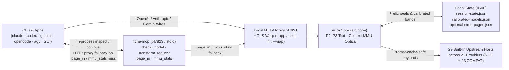

# Architecture

`fiche` separates a runtime-agnostic compiler core (`src/core/`, zero `node:` imports and zero runtime `Buffer` references) from thin host adapters for Node.js, Cloudflare Workers, TLS Warp, MCP, CLI utilities, and the macOS menu bar app.

## Topology

## Module Layout

| Layer | Key Files | Responsibilities |
| --- | --- | --- |
| **Pure Core** | `src/core/proxy.ts`, `prefix-tape.ts`, `schema-compiler.ts`, `text-hygiene.ts`, `casi-delta.ts`, `calibration.ts`, `text-history.ts`, `context-mmu.ts`, `session-state.ts`, `reader-tier.ts` | P0 XML-Island TSCG, Merkle Schema DAG (`$defs._fN`) & `PrefixMemoTape`, P1 `CASI` (`PREPARED_LINES_CACHE`, Recursive Histogram Diff, FastCDC) & 4-axis calibration, P2 `LSM-Context` (`L1/L0/L2`, `computeHorizonPaybackLimit`), P3 `Context-MMU` (`pg_<12hex>`, Per-Session Context-TLB, Markovian folding, Turn-1 skill linking, Minoux Submodular IDF pruning), append-only prefix sealing |
| **Wire Adapters** | `src/core/google.ts`, `transform.ts`, `openai.ts` | Provider wire translation, `OpticalMode` (`hybrid` Turn-1 optical slab + dynamic Text-MMU vs `full` optical), Google `pinnedUserText` live-tail split, active-turn-only tail extractors, `!opticalEnabled` guard disabling `CASI` in Full Optical |
| **Daemon & CLI** | `src/node.ts`, `src/node-fetch.ts`, `src/launchd-socket.ts`, `mmu-store.ts`, `calibrate.ts`, `turn-report.ts` | `:47821` daemon with HTTP/1.1 keep-alive upstream fetch (`#33`), `launchd`/`systemd` socket activation + bind-before-restore + `connTrack` `60s` SSE drain (`#34`), `fiche calibrate`, `fiche mmu`, `fiche turn-report`, `fiche export`, optional `FICHE_MMU_PERSIST=1` `0600` persistence |
| **UI & Extensions** | `src/dashboard.ts`, `src/mcp/server.ts`, `src/warp/`, `apps/macos-bar/` | Warm Paper dashboard + `no-store`/`nosniff` `/api/mmu/*` & `/api/calibration`, MCP server (`6` tools), HTTPS `CONNECT` warp (`isLocalDaemonReachable`, `failOpenOnDivertRefused`, loopback `NO_PROXY`), native SwiftUI `FicheBar.app` |

## Request & Prefix-Cache Invariants

1. **RAM-First MMU Default**: `ContextPageStore` runs purely in daemon memory by default; persistence to `~/.fiche/mmu-pages.json` requires explicit opt-in (`FICHE_MMU_PERSIST=1` with `FICHE_SESSION_STATE` enabled) and skips pages matching high-confidence secret patterns with a 24-hour idle TTL.
2. **Edit & Read Protection**: `FILE_READ_TOOL_RE` and `isCodeOrDiffProtected` bypass destructive pruning (`pruneLowDensityBlob`) and aggressive compaction, keeping edits and code reads verbatim in the live tail.
3. **Append-Only Sealed Prefix, Context-TLB & PrefixMemoTape**: `PrefixMemoTape` (`src/core/prefix-tape.ts`) accelerates warm turns via Stage-2 LRU memoization, `sessionKey`-scoped Unified Prefix Seals (`L1`/`L0`/Markov), and Merkle prefix-state CASI memos with chronological `deferredBases` seeding. Turn-1 skill catalogs are pinned (`PINNED_SKILLS_MAX = 32` across `512` LRU sessions) in `session-state.ts`, while `computeTailHydration` filters queries to active trailing turns and suppresses redundant re-hydrations via per-session Context-TLB (`TLB_DEFAULT_COOLDOWN_TURNS = 3`) across `±15`-line slices in the uncached live tail.
4. **Hybrid Slab-Optical + Text-MMU & Live-Tail Read Safety**: `resolveOpticalHistoryPolicy` (`transform.ts`) selects `opticalMode: 'hybrid'` under low read-discount `kosha` pricing (`rates.read <= 0.10`, `estPromptTokens < 160_000`), freezing Turn-1 instructions/schemas optically once while running Text + `Context-MMU` on dynamic history (`39.5%` weighted / `46.9%` raw saved at `89.9%` cache hit across `60` images on `gemini-4-argon`, vs. `36.8%` weighted / `44.0%` raw on 0-image Text+MMU and `3.0%` weighted / `49.0%` raw across `153` PNGs in Full Optical—all with `editSafe = true` and `tailRecallVerified = true`). Full Optical disables `CASI` (`!opticalEnabled`), keeps live-tail reads verbatim until sealed, and places mutable `pinnedUserText` in the trailing live turn (`79.7%` cache hit vs `11.9%`).
5. **Cold-Cache & Online Horizon Triggers**: `L2` cold repack runs only when upstream `usage` confirms cache expiry (`everCacheAlive && !lastCacheAlive`, `1h + 30s` idle, or `413` backstop) with `justRepacked` hysteresis across all `5` provider cache-read JSON `usage` fields; mid-prefix compaction passes through `computeHorizonPaybackLimit`.
6. **Zero-Drop Transport, Socket Activation & Warp Fail-Open**: `src/node-fetch.ts` uses dedicated HTTP/1.1 keep-alive agents with persistent socket `'error'` listeners and `AbortController` teardown (preventing Node 26 / `undici` idle-reaper `ClientHttp2Stream` crashes, `#33`). `src/launchd-socket.ts` + `src/node.ts` adopt `launchd` (`<key>Sockets</key>` `<launch.h>` trampoline) or `systemd` (`LISTEN_FDS`/`LISTEN_PID`) fds before store/replay restoration (`#34`) while protecting freshly accepted sockets across `SIGTERM`, and `src/warp/` bypasses dead daemons (`FICHE_BYPASS=1`), merges loopback `NO_PROXY`, and fails open direct on mid-session `ECONNREFUSED`.

## Benchmark Snapshot (`bench/context-mmu-eval.mts`, 30 Turns, `gemini-4-argon`, `kosha` pricing)

| Arm | Raw Save | Weighted Save (`kosha`) | Cache Hit | p50 / p95 ms | EditSafe | Tail Recall |
| --- | ---: | ---: | ---: | ---: | :---: | :---: |
| Baseline (uncompressed) | 0.0% | 0.0% | 91.8% | 0.00 / 0.01 | `true` | `true` |
| v0.18 Text (`lsm/mmu/skillLinker` off) | 32.5% | 34.0% | 92.1% | 11.94 / 16.33 | `true` | `true` |
| P0–P3 Text + Context-MMU (0 images) | 44.0% | 36.8% | 90.1% | 10.24 / 35.53 | `true` | `true` |
| P0–P3 + Optical (`spleen-5x8`, 153 imgs) | 49.0% | 3.0% | 79.7% | 4.71 / 54.07 | `true` | `true` |
| **P0–P3 Hybrid Slab-Optical + Text-MMU** (`60` imgs) | **46.9%** | **39.5%** | **89.9%** | **9.62 / 32.41** | `true` | `true` |

Cross-wire 30-turn verification (`kosha` pricing): Anthropic (`claude-opus-5-5`) achieves `48.8%` raw / `39.8%` weighted saved (`89.6%` cache hit, `18.50 ms` avg, `42.65 ms` p95); OpenAI Responses (`gpt-6-astra`) achieves `44.6%` raw / `33.2%` weighted saved (`88.3%` cache hit, `11.66 ms` avg, `15.50 ms` p95); both `editSafe = true` and `tailRecallVerified = true`.
