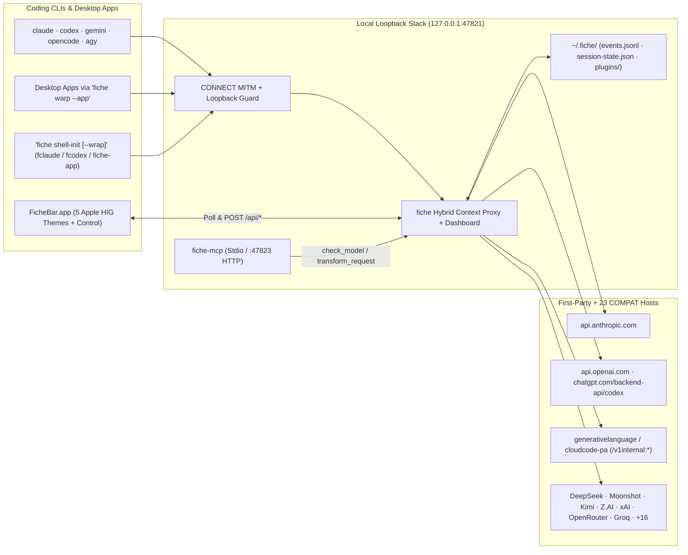
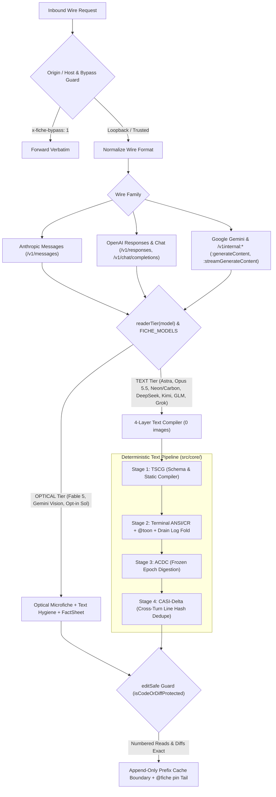
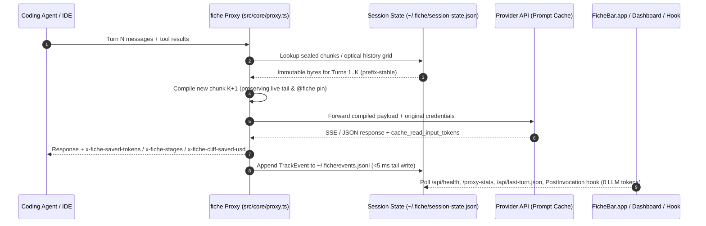

# Architecture

`fiche` intercepts inference traffic (or transforms payloads offline via library / MCP / `fiche export`) using a clean split between a **pure runtime-agnostic core** (`src/core/`, zero `node:` imports) and **host adapters** (`src/node.ts`, `src/worker.ts`, `src/warp/`, `src/mcp/`, `apps/macos-bar/`).

---

## 1. End-to-End Topology

---

## 2. Hybrid Context Compiler Router

---

## 3. Prefix-Cache Seal & Zero-Token Telemetry Sequence

---

## 4. Module Map (`src/` & `apps/`)

| Module | Path | Responsibility |
| :--- | :--- | :--- |
| **Pure Core Engine** | `src/core/` | Zero `node:` imports: wire transforms (`transform.ts`, `openai.ts`, `google.ts`), 4-layer text pipeline (`schema-compiler.ts`, `text-hygiene.ts`, `toon.ts`, `text-history.ts`, `casi-delta.ts`), optical PNG renderer (`render.ts`, `atlas*.ts`, `png.ts`, `factsheet.ts`), cache state (`session-state.ts`, `codex-cache.ts`), 23-host COMPAT registry (`upstream-hosts.ts`), `kosha` pricing & baselines (`pricing.ts`, `baseline.ts`, `measurement.ts`), and plugins (`stage-plugins.ts`) |
| **Loopback Proxy & CLI** | `src/node.ts`, `src/worker.ts` | Local HTTP daemon (`127.0.0.1:47821`), Cloudflare Workers adapter, `fiche export`, `fiche turn-report`, `fiche stats`, `fiche service` (`launchd`) |
| **TLS Warp & App Launch** | `src/warp/` | Local HTTPS `CONNECT` interceptor (`connect.ts`, `ca.ts`, `resolve.ts`, `route.ts`) + macOS GUI launcher & shell helpers (`app-launch.ts`) for `fiche warp --app` and `fiche shell-init [--wrap]` |
| **Local Dashboard** | `src/dashboard.ts`, `src/dashboard/` | Editorial Warm Paper live telemetry dashboard, PNG crop inspector, `/fragments/plugins`, and `/api/models` / `/api/plugins` controls |
| **MCP Server** | `src/mcp/` | Stdio & stateless Streamable HTTP MCP server (`fiche-mcp` / `:47823`) exposing `check_model`, `transform_request`, `health`, `stats` |
| **Fast Telemetry Tail** | `src/turn-report.ts`, `src/sessions.ts`, `src/stats.ts` | Bounded reverse-tail buffer scanner (`<5 ms`) powering CLI rollups, Antigravity `PostInvocation`, and Claude `statusLine` |
| **macOS Companion** | `apps/macos-bar/` | Native Swift 6 / SwiftUI `FicheBar.app` with 5 Apple HIG themes (`Editorial`, `Native`, `Slate`, `Terminal`, `Midnight`), weighted-vs-raw savings readout, 1-click third-party toggles, and About/Sponsor window |

---

## 5. Model Routing & Font Bands (`src/core/reader-tier.ts`)

1. **Dense 5×8 bitmap (`spleen-5x8`, 5×8 cell + `Unifont` 8px fallback)**: `claude-fable-5`, measured `gemini` vision tiers (`gemini-3.6-flash`, `3.7-flash`, `3.8-flash`, `gemini-4-argon`), `gpt-6` (non-Sol), and default GPT fallback (`312` cols on Claude/Gemini, `152` cols on GPT).
2. **Spaced 5×8 bitmap (`spleen-5x8` + `2px` row spacing → 5×10 cell)**: `claude-fable-5-1`, `claude-fable-5-2`, and other opt-in Claude models (`312` cols, `1568×728` max). Intermediate `jetbrains-mono-10` (`6×11`) and `jetbrains-mono-12` (`8×13`) atlases are also compiled for `FICHE_GPT_PROFILES`.
3. **Native 14px (`jetbrains-mono-14`, 9×16 cell + `Unifont` 14px fallback)**: opt-in `gpt-5.6-sol` / `gpt-6.1-sol` / `gpt-6.2-sol` (`84` cols, `764×1954`), opt-in `grok-*` (`84` cols, `764×512`), and opt-in `qwen3.8-27b` (`84` cols, `764×512`, `providerImageCap: 32`).
4. **Text-only deterministic hygiene (zero images)**: `claude-opus-5-5`, `claude-sonnet-5-5`, `claude-haiku-*`, `gpt-6*-astra`, `gemini-4-neon`, `gemini-4-carbon`, `gemini-4-hydrogen`, `deepseek`, `kimi`, `glm`, `minimax`, and `grok` (unless `FICHE_FORCE_IMAGES=1`). Includes Google `/v1internal:*` `functionResponse.parts[].text` compression for non-Gemini models routed through Antigravity.

## Further Reading

- [Detailed Architecture Reference](../docs/ARCHITECTURE.md)
- [Hybrid Optical Engine](./Hybrid-Optical-Engine.md) · [4-Layer Text Compiler](./Text-Compiler-Pipeline.md)
- [Prefix Cache Safety & Kosha Pricing](./Prefix-Cache-Safety-and-Pricing.md)
- [Security Model](../docs/SECURITY_MODEL.md) · [Privacy Policy](../PRIVACY.md)
