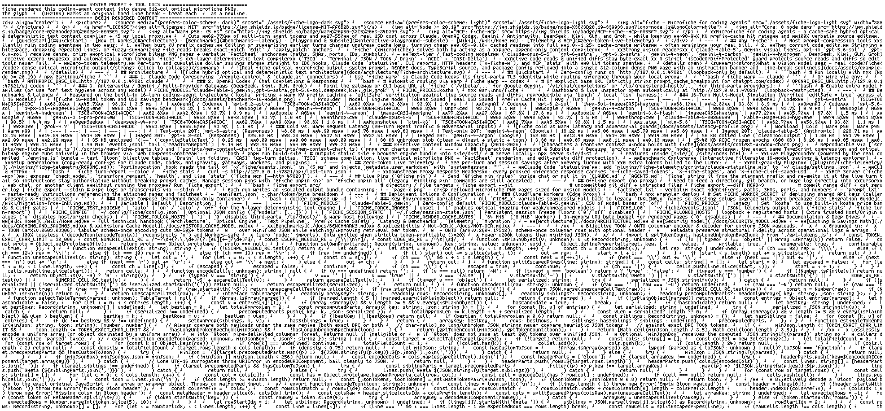

# Hybrid Optical Engine

Optical microfiche rendering (`src/core/render.ts`, `src/core/png.ts`, `src/core/factsheet.ts`) turns bulky stale blocks (system slabs, old conversation turns, huge tool logs) into dense bitmap PNG pages for models empirically measured to read compact typography accurately.

## Why Optical Microfiche Works (and When It Doesn't)

- **Validated Strong Readers**: `claude-fable-5` (5×8 dense; `claude-fable-5-1`/`5-2` with `+2px` spaced rows), vision-tier Gemini (`gemini-4-argon`, `gemini-3.8-flash`, `gemini-3.6-flash`, `gemini-3.7-flash`), and opt-in 14px profiles (`gpt-5.6-sol`, `gpt-6.1-sol`, `gpt-6.2-sol`, `grok-*`, `qwen3.8-27b`) decode compact glyph pages reliably at fewer vision tokens than raw UTF-8 BPE text (**35.1%–51.9% token reduction** across 16-turn agent benchmarks, saving **27.9%–34.6% USD** on Fable 5 / Gemini vision tiers).
- **Text-Tier Protection**: Unmeasured or weak bitmap readers (e.g., `claude-opus-5-5`, `claude-sonnet-5-5`, `claude-haiku-*`, `gpt-6*-astra`, `grok-4.7`, `gemini-4-neon/carbon/hydrogen`, `deepseek`, `kimi`, `glm`, `minimax`) automatically skip image rendering (`readerTier === 'text'`) unless explicitly overridden via `FICHE_FORCE_IMAGES=1`.

## Bitmap Pipeline

1. **Reflow (`reflow`)**: Normalizes trailing whitespace, collapses redundant blank lines, and joins short lines with the sentinel `↵` so 25-column source code fills full-width canvas rows instead of wasting ~75% of image width.
2. **Content-Width Sizing (`measureContentCols`)**: Streaming scan using a 128-entry ASCII width/rank lookup table (`buildAsciiRankLut`) with independent visual `col` and `tabCol` tracking and early `cap` termination.
3. **Atlas Blitting**: Renders grayscale or role-colored RGB pixels from build-time pre-rasterized font atlases (`src/core/atlas*.ts`):
   - **Spleen 5×8** (`spleen-5x8`, BSD 2-Clause, `assets/SPLEEN_LICENSE.txt`) with **GNU Unifont 16.0.04** fallback (SIL Open Font License 1.1 / GPLv2+ with GNU font embedding exception, `assets/UNIFONT_LICENSE.txt`) for non-ASCII BMP glyphs.
   - **JetBrains Mono 10 / 12 / 14px** (`jetbrains-mono-10`, `jetbrains-mono-12`, `jetbrains-mono-14`, SIL OFL 1.1, `assets/JETBRAINS_MONO_LICENSE.txt`) with GNU Unifont fallback. All three license files are also bundled in `/app/licenses/` in Docker.
4. **Average-Filter PNG (`src/core/png.ts`)**: Uses PNG filter type 3 (Average residual) with branchless row loops and native `Uint8Array.prototype.toBase64` encoding + `CompressionStream('deflate')`, shrinking IDAT payload size by ~34% vs unfiltered PNG while decoding bit-identically.

## Verbatim `FactSheet` Companion (`src/core/factsheet.ts`)

Pixels carry bulk prose and context cleanly, but exact strings (URLs, paths, SHAs, ports, ticket IDs, currencies, identifiers) are extracted deterministically and kept in text alongside the images:
- Uses a single-pass character bitmask (`chunkCharMask`) against `SAFE_PATTERN_REQ_MASK` over 17 token extractors.
- Collapses substrings cleanly in length-descending order (`joinedSpecific`) so full URLs/paths keep priority without duplicating prefixes.
- Memoized in a 512-entry LRU keyed by a 128-bit digest (`factSheetDigestKey`) so repeated slabs retain zero large raw strings in RAM.
