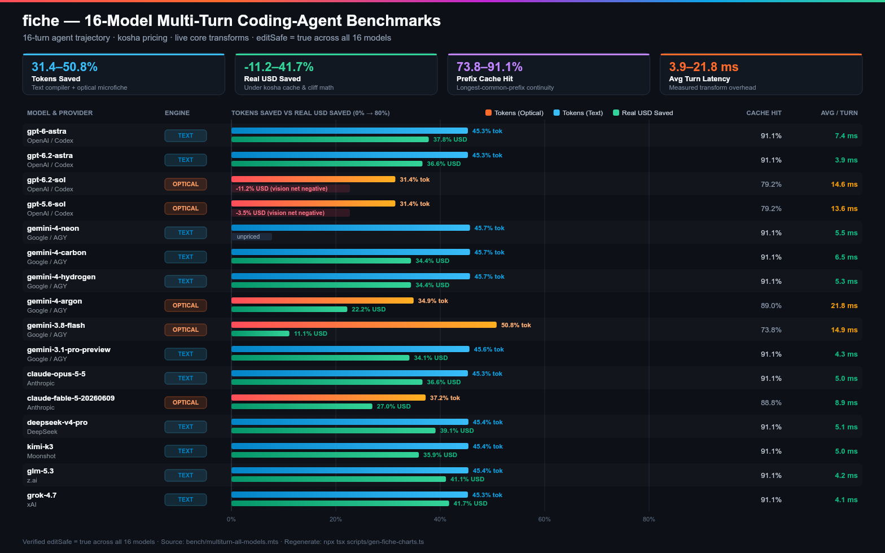
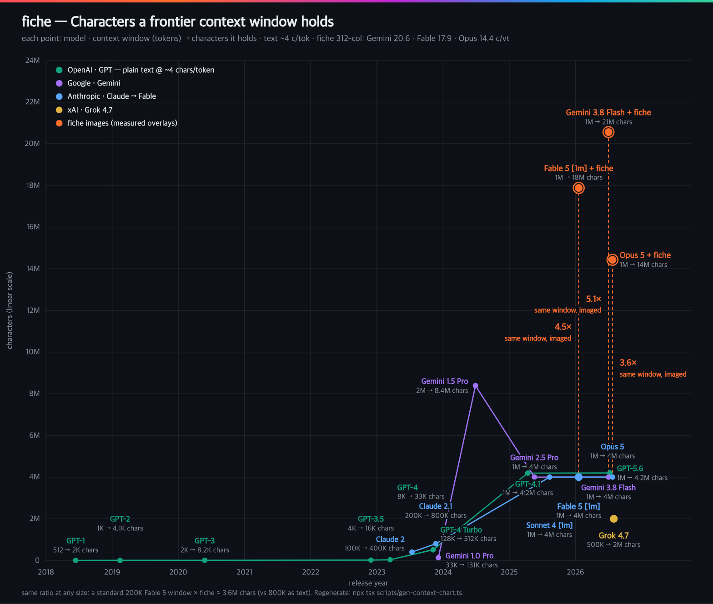

# Latency & Benchmarks

`fiche` is engineered so context compilation stays nearly invisible compared to upstream LLM network/TTFT latency — **6.29–6.66 ms** warm p50 on 20-turn text paths and **1.99–3.53 ms** warm p50 on imaged optical paths (with **3.9–21.8 ms** per-turn averages across full 16-turn trajectories).

## Hot-Path Engineering

1. **Eliminated Backtracking Traps**:
   - `hasFileLineLocation` (`src/core/text-hygiene.ts`): Linear O(L) backward scan from `FILE_EXT_LOC_RE` matches — removes O(L²) backtracking on long dotted lines.
   - `stripHtmlComments` (`src/core/schema-compiler.ts`): Linear index scanner avoiding O(N²) unclosed `<!--` scans.
   - `stripReminders` (`src/core/pin.ts`): Linear tag scanner.
2. **Prefix-State Memo Tape & Bounded Prep Cache (`src/core/prefix-tape.ts`, `casi-delta.ts`)**:
   - `PrefixMemoTape` caches deterministic Stage-2 clean outputs (`1024` entries / `12 MiB`), session-scoped Unified Prefix Seals (`512` × `512`), and Merkle prefix-state CASI memos (`1024` / `8 MiB`), while `PREPARED_LINES_CACHE` (`192` entries, `>= 256` chars) skips redundant FastCDC rolling-hash / line-split work across warm turns.
3. **Symmetric Linear BPE Guards (`src/core/gpt-tokens.ts`)**:
   - `MEMO_MIN_CHARS = 128` caches exact `o200k_base` counts for repeated strings.
   - `hasLongUnbrokenBpeChunk` skips O(M²) pure-JS BPE merge loops on massive unbroken letter/symbol blobs while keeping fast (<2 ms) exact BPE on minified JSON delimited by `":,{};<>/.\\'`.
   - `estimateTokenPair` (`src/core/toon.ts`) and `estimateTokensSaved` (`src/core/text-hygiene.ts`) compare JSON/raw vs. compressed payloads under the same regime so estimates stay balanced.
4. **Zero-Branch PNG Filtering & Native Base64 (`src/core/png.ts`)**:
   - `filterAverage` hoists row-0 and left-border cases out of the inner pixel loop (bit-identical PNG output) and `bytesToBase64` uses native `Uint8Array.prototype.toBase64` when available.
5. **ASCII LUTs, Streaming Wrap Measurement & Buffer Tail Scans**:
   - `buildAsciiRankLut` (`src/core/render.ts`) avoids binary glyph lookups across printable ASCII.
   - `measureContentCols` streams width with early `cap` termination and independent `col`/`tabCol` tracking.
   - `readTurnReport` (`src/turn-report.ts`) reads only a bounded trailing window via `readTailBuffer`, reverse-scans from EOF via `Buffer.lastIndexOf(0x0a)`, and pre-filters sessions using native `Buffer.includes` before `JSON.parse`.

## Observed Cold vs. Warm Latency (`bench/latency-p99.mts`)

| Workload | Cold | Warm p50 | Warm p95 | Warm p99 |
| :--- | ---: | ---: | ---: | ---: |
| Text-only 20T: `gpt-6-astra` (OpenAI Responses) | 13.77 ms | **6.29 ms** | 7.81 ms | 9.40 ms |
| Text-only 20T: `gemini-4-neon` (Google) | 11.16 ms | **6.66 ms** | 9.43 ms | 28.30 ms |
| Imaged 20T: `gpt-6.2-sol` (OpenAI Responses) | 79.37 ms | **3.53 ms** | 5.52 ms | 6.49 ms |
| Imaged 20T: `claude-fable-5` (Anthropic) | 53.68 ms | **3.13 ms** | 3.75 ms | 4.19 ms |
| Imaged 20T: `gemini-4-argon` (Google) | 48.02 ms | **1.99 ms** | 2.80 ms | 3.02 ms |
| Adv: 35 KB unclosed `<!--` (`compileStaticText`) | 0.25 ms | **0.27 ms** | 0.50 ms | 0.67 ms |
| Adv: 600 KB ACDC epochs (`15×40 KB`) | 59.06 ms | **15.93 ms** | 19.19 ms | 20.97 ms |
| Adv: 30 KB unbroken blob (clean + digest + static + toon) | 1.03 ms | **0.90 ms** | 1.55 ms | 2.45 ms |
| Adv: 30 KB blob (Responses) | 0.99 ms | **0.29 ms** | 0.53 ms | 0.73 ms |
| Adv: 50 KB dotted line (`cleanToolOutput`) | 1.52 ms | **1.26 ms** | 1.82 ms | 2.57 ms |
| Event log tail: 1.90 MiB `events.jsonl` (`readTurnReport`) | 0.79 ms | **0.43 ms** | 1.16 ms | 1.77 ms |

## Efficiency vs. Latency Frontier (`bench/multiturn-all-models.mts`)

## `v0.19` 30-Turn `Context-MMU` Replay (`bench/context-mmu-eval.mts` → `bench/mmu-results.generated.json`)

Hardened 30-turn coding trajectory (`904,363` baseline raw tokens / `115,675` `kosha`-weighted tokens at `0.05×` read on `gemini-4-argon`, plus Anthropic & OpenAI Responses cross-wire checks):

| Arm (`30` Turns) | Raw Save | Weighted Save (`kosha`) | KV Cache Hit | p50 / p95 ms | EditSafe | Tail Recall |
| :--- | ---: | ---: | ---: | ---: | :---: | :---: |
| Baseline (uncompressed) | `0.0%` | `0.0%` | `91.8%` | `0.00 / 0.01` | `true` | `true` |
| `v0.18` Text (`lsm/mmu/skillLinker` off) | `32.5%` | `34.0%` | `92.1%` | `11.94 / 16.33` | `true` | `true` |
| **`P0–P3` Text + `Context-MMU`** (`0` images) | **`44.0%`** | **`36.8%`** | **`90.1%`** | **`10.24 / 35.53`** | **`true`** | **`true`** |
| **`P0–P3` + Optical** (`spleen-5x8`, `153` imgs) | **`49.0%`** | **`3.0%`** | **`79.7%`** | **`4.71 / 54.07`** | **`true`** | **`true`** |
| **`P0–P3` Hybrid Slab-Optical + Text-MMU** (`60` imgs) | **`46.9%`** | **`39.5%`** | **`89.9%`** | **`9.62 / 32.41`** | **`true`** | **`true`** |

- **Cross-wire Anthropic (`claude-opus-5-5`, `kosha` pricing)**: `48.8%` raw / `39.8%` weighted saved (`89.6%` cache hit, `18.50 ms` avg, `42.65 ms` p95, `13` active stages, `editSafe=true`, `tailRecallVerified=true`).
- **Cross-wire OpenAI Responses (`gpt-6-astra`, `kosha` pricing)**: `44.6%` raw / `33.2%` weighted saved (`88.3%` cache hit, `11.66 ms` avg, `15.50 ms` p95, `13` active stages, `editSafe=true`, `tailRecallVerified=true`).

---

## Observed 16-Turn Coding-Agent Benchmark (`bench/multiturn-all-models.mts`)

All 16 tested models preserved `editSafe = true` across live source reads and unified diffs (`bench/results.generated.json`):

| Provider | Model | Mode | Tokens Saved | USD Saved | Prefix Hit | Avg / Turn |
| :--- | :--- | :--- | ---: | ---: | ---: | ---: |
| OpenAI / Codex | `gpt-6-astra` | `TSCG+TOON+ACDC+CASI` | **45.3%** | **37.8%** | 91.1% | 7.4 ms |
| OpenAI / Codex | `gpt-6.2-astra` | `TSCG+TOON+ACDC+CASI` | **45.3%** | **36.6%** | 91.1% | 3.9 ms |
| OpenAI / Codex | `gpt-6.2-sol` | `14px-Sol-image+hygiene` | **31.4%** | -11.2% | 79.2% | 14.6 ms |
| OpenAI / Codex | `gpt-5.6-sol` | `14px-Sol-image+hygiene` | **31.4%** | -3.5% | 79.2% | 13.6 ms |
| Google / AGY | `gemini-4-neon` | `TSCG+TOON+ACDC+CASI` | **45.7%** | unpriced | 91.1% | 5.5 ms |
| Google / AGY | `gemini-4-carbon` | `TSCG+TOON+ACDC+CASI` | **45.7%** | **34.4%** | 91.1% | 6.5 ms |
| Google / AGY | `gemini-4-hydrogen` | `TSCG+TOON+ACDC+CASI` | **45.7%** | **34.4%** | 91.1% | 5.3 ms |
| Google / AGY | `gemini-4-argon` | `image+hygiene` | **34.9%** | **22.2%** | 89.0% | 21.8 ms |
| Google / AGY | `gemini-3.8-flash` | `image+hygiene` | **50.8%** | **11.1%** | 73.8% | 14.9 ms |
| Google / AGY | `gemini-3.1-pro-preview` | `TSCG+TOON+ACDC+CASI` | **45.6%** | **34.1%** | 91.1% | 4.3 ms |
| Anthropic | `claude-opus-5-5` | `TSCG+TOON+ACDC+CASI` | **45.3%** | **36.6%** | 91.1% | 5.0 ms |
| Anthropic | `claude-fable-5-20260609` | `Fable-image+hygiene` | **37.2%** | **27.0%** | 88.8% | 8.9 ms |
| DeepSeek | `deepseek-v4-pro` | `TSCG+TOON+ACDC+CASI` | **45.4%** | **39.1%** | 91.1% | 5.1 ms |
| Moonshot | `kimi-k3` | `TSCG+TOON+ACDC+CASI` | **45.4%** | **35.9%** | 91.1% | 5.0 ms |
| z.ai | `glm-5.3` | `TSCG+TOON+ACDC+CASI` | **45.4%** | **41.1%** | 91.1% | 4.2 ms |
| xAI | `grok-4.7` | `TSCG+TOON+ACDC+CASI` | **45.3%** | **41.7%** | 91.1% | 4.1 ms |

## Effective Context Window Capacity (2018–2026)

