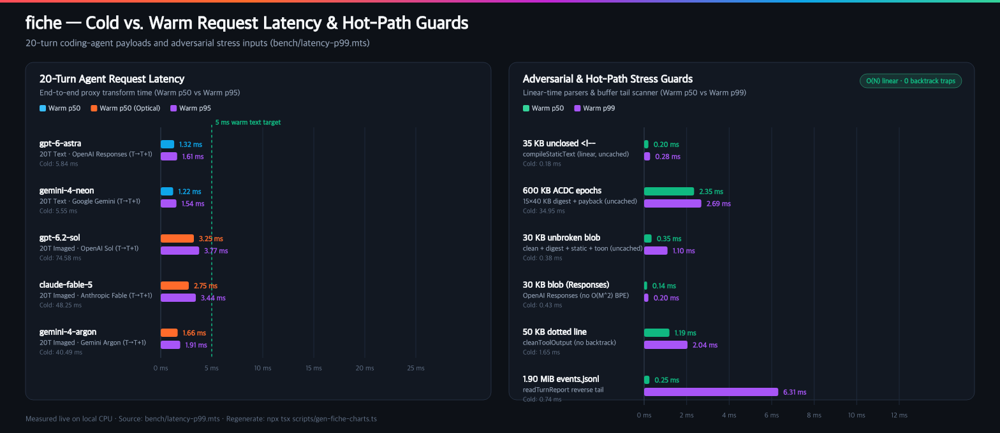
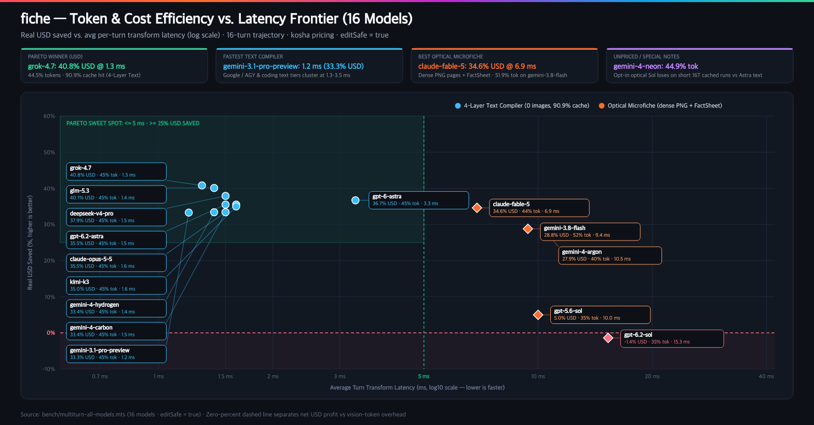

# Latency & Benchmarks

`fiche` is engineered so context compilation stays nearly invisible compared to upstream LLM network/TTFT latency — **1.22–1.32 ms** warm p50 on 20-turn text paths and **1.66–3.25 ms** warm p50 on imaged optical paths (with **1.2–15.3 ms** per-turn averages across full 16-turn trajectories).

## Hot-Path Engineering

1. **Eliminated Backtracking Traps**:
   - `hasFileLineLocation` (`src/core/text-hygiene.ts`): Linear O(L) backward scan from `FILE_EXT_LOC_RE` matches — removes O(L²) backtracking on long dotted lines.
   - `stripHtmlComments` (`src/core/schema-compiler.ts`): Linear index scanner avoiding O(N²) unclosed `<!--` scans.
   - `stripReminders` (`src/core/pin.ts`): Linear tag scanner.
2. **Symmetric Linear BPE Guards (`src/core/gpt-tokens.ts`)**:
   - `MEMO_MIN_CHARS = 128` caches exact `o200k_base` counts for repeated strings.
   - `hasLongUnbrokenBpeChunk` skips O(M²) pure-JS BPE merge loops on massive unbroken letter/symbol blobs while keeping fast (<2 ms) exact BPE on minified JSON delimited by `":,{};<>/.\\'`.
   - `estimateTokenPair` (`src/core/toon.ts`) and `estimateTokensSaved` (`src/core/text-hygiene.ts`) compare JSON/raw vs. compressed payloads under the same regime so estimates stay balanced.
3. **Zero-Branch PNG Filtering & Native Base64 (`src/core/png.ts`)**:
   - `filterAverage` hoists row-0 and left-border cases out of the inner pixel loop (bit-identical PNG output) and `bytesToBase64` uses native `Uint8Array.prototype.toBase64` when available.
4. **ASCII LUTs, Streaming Wrap Measurement & Buffer Tail Scans**:
   - `buildAsciiRankLut` (`src/core/render.ts`) avoids binary glyph lookups across printable ASCII.
   - `measureContentCols` streams width with early `cap` termination and independent `col`/`tabCol` tracking.
   - `readTurnReport` (`src/turn-report.ts`) reads only a bounded trailing window via `readTailBuffer`, reverse-scans from EOF via `Buffer.lastIndexOf(0x0a)`, and pre-filters sessions using native `Buffer.includes` before `JSON.parse`.

## Observed Cold vs. Warm Latency (`bench/latency-p99.mts`)

| Workload | Cold | Warm p50 | Warm p95 | Warm p99 |
| :--- | ---: | ---: | ---: | ---: |
| Text-only 20T: `gpt-6-astra` (OpenAI Responses) | 5.84 ms | **1.32 ms** | 1.61 ms | 1.80 ms |
| Text-only 20T: `gemini-4-neon` (Google) | 5.55 ms | **1.22 ms** | 1.54 ms | 1.68 ms |
| Imaged 20T: `gpt-6.2-sol` (OpenAI Responses) | 74.58 ms | **3.25 ms** | 3.77 ms | 4.10 ms |
| Imaged 20T: `claude-fable-5` (Anthropic) | 48.25 ms | **2.75 ms** | 3.44 ms | 3.48 ms |
| Imaged 20T: `gemini-4-argon` (Google) | 40.49 ms | **1.66 ms** | 1.91 ms | 1.93 ms |
| Adv: 35 KB unclosed `<!--` (`compileStaticText`) | 0.18 ms | **0.20 ms** | 0.25 ms | 0.28 ms |
| Adv: 600 KB ACDC epochs (`15×40 KB`) | 34.95 ms | **2.35 ms** | 2.54 ms | 2.69 ms |
| Adv: 30 KB unbroken blob (clean + digest + static + toon) | 0.38 ms | **0.35 ms** | 0.50 ms | 1.10 ms |
| Adv: 30 KB blob (Responses) | 0.43 ms | **0.14 ms** | 0.19 ms | 0.20 ms |
| Adv: 50 KB dotted line (`cleanToolOutput`) | 1.65 ms | **1.19 ms** | 1.39 ms | 2.04 ms |
| Telemetry: 1.90 MiB `events.jsonl` (`readTurnReport`) | 0.74 ms | **0.25 ms** | 0.57 ms | 6.31 ms |

## Efficiency vs. Latency Frontier (`bench/multiturn-all-models.mts`)

## Observed 16-Turn Coding-Agent Benchmark (`bench/multiturn-all-models.mts`)

All 16 tested models preserved `editSafe = true` across live source reads and unified diffs (`bench/results.generated.json`):

| Provider | Model | Mode | Tokens Saved | USD Saved | Prefix Hit | Avg / Turn |
| :--- | :--- | :--- | ---: | ---: | ---: | ---: |
| OpenAI / Codex | `gpt-6-astra` | `TSCG+TOON+ACDC+CASI` | **44.5%** | **36.7%** | 90.9% | 3.3 ms |
| OpenAI / Codex | `gpt-6.2-astra` | `TSCG+TOON+ACDC+CASI` | **44.5%** | **35.5%** | 90.9% | 1.5 ms |
| OpenAI / Codex | `gpt-6.2-sol` | `14px-Sol-image+hygiene+CASI` | **35.1%** | -1.4% | 80.9% | 15.3 ms |
| OpenAI / Codex | `gpt-5.6-sol` | `14px-Sol-image+hygiene+CASI` | **35.1%** | 5.0% | 80.9% | 10.0 ms |
| Google / AGY | `gemini-4-neon` | `TSCG+TOON+ACDC+CASI` | **44.9%** | unpriced | 90.9% | 2.0 ms |
| Google / AGY | `gemini-4-carbon` | `TSCG+TOON+ACDC+CASI` | **44.9%** | **33.4%** | 90.9% | 1.5 ms |
| Google / AGY | `gemini-4-hydrogen` | `TSCG+TOON+ACDC+CASI` | **44.9%** | **33.4%** | 90.9% | 1.4 ms |
| Google / AGY | `gemini-4-argon` | `image+hygiene+CASI` | **39.7%** | **27.9%** | 90.0% | 10.5 ms |
| Google / AGY | `gemini-3.8-flash` | `image+hygiene+CASI` | **51.9%** | **28.8%** | 84.0% | 9.4 ms |
| Google / AGY | `gemini-3.1-pro-preview` | `TSCG+TOON+ACDC+CASI` | **44.9%** | **33.3%** | 90.9% | 1.2 ms |
| Anthropic | `claude-opus-5-5` | `TSCG+TOON+ACDC+CASI` | **44.5%** | **35.5%** | 90.8% | 1.6 ms |
| Anthropic | `claude-fable-5-20260609` | `Fable-image+hygiene+CASI` | **43.6%** | **34.6%** | 90.0% | 6.9 ms |
| DeepSeek | `deepseek-v4-pro` | `TSCG+TOON+ACDC+CASI` | **44.6%** | **37.9%** | 90.9% | 1.5 ms |
| Moonshot | `kimi-k3` | `TSCG+TOON+ACDC+CASI` | **44.6%** | **35.0%** | 90.9% | 1.6 ms |
| z.ai | `glm-5.3` | `TSCG+TOON+ACDC+CASI` | **44.6%** | **40.1%** | 90.9% | 1.4 ms |
| xAI | `grok-4.7` | `TSCG+TOON+ACDC+CASI` | **44.5%** | **40.8%** | 90.9% | 1.3 ms |

## Effective Context Window Capacity (2018–2026)

